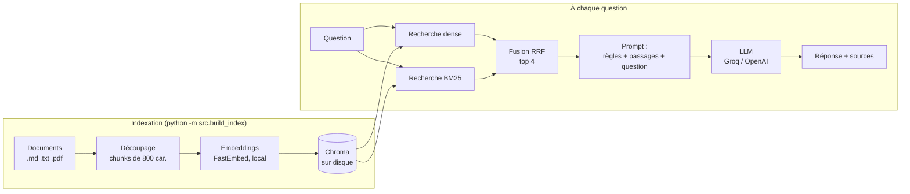

# RAG sur mes notes


Assistant de questions-réponses sur des documents personnels (notes, cours,
PDF) construit avec un pipeline **RAG** (Retrieval-Augmented Generation) :
chaque réponse est générée **uniquement** à partir des passages retrouvés
dans les documents, et cite ses sources. Si l'information n'y est pas,
l'assistant répond qu'il ne sait pas au lieu d'inventer.

**Points clés**
- Recherche **hybride** (embeddings + BM25) : +18 points de Hit@1 mesurés par rapport à la recherche sémantique seule
- **Évaluation chiffrée** reproductible (retrieval et réponses), pas seulement « ça a l'air de marcher »
- **0 hallucination** sur les questions hors périmètre du jeu d'évaluation
- Formats `.md`, `.txt` et **`.pdf`** (citations avec numéro de page)
- Interface **chat Streamlit** avec passages sources affichés, ajout de documents depuis la page
- **Tests sans clé API** (LLM simulé), CI GitHub Actions, image **Docker**
- 100 % gratuit : embeddings locaux (CPU), LLM via le tier gratuit de Groq

## Résultats

Mesurés avec `python -m src.evaluate --llm` sur 22 questions formulées
différemment des notes (ex. « quelle taille de morceau choisir ? » pour
un passage qui parle de « chunks ») et 4 questions hors périmètre.

| Retrieval (k=4) | Hit@1 | Hit@4 | MRR |
|---|---|---|---|
| Dense (embeddings seuls) | 68 % | 91 % | 0.76 |
| **Hybride (embeddings + BM25)** | **86 %** | **95 %** | **0.90** |

| Génération (`openai/gpt-oss-20b`, mode hybride) | Score |
|---|---|
| Questions du périmètre auxquelles l'assistant répond | 95 % (21/22) |
| Questions hors périmètre correctement refusées | 100 % (4/4) |

La seule question sans réponse (« Que signifie l'option -d ? ») est aussi
la seule dont le retrieval rate le bon passage : le modèle a répondu « je ne
sais pas » plutôt que d'inventer, ce qui est le comportement voulu. Elle
illustre une limite réelle : une question très courte, sans contexte, et un
terme (`-d`) que le découpage en mots de BM25 réduit à « d ».

**Glossaire** — *Hit@1* : le bon passage est classé premier. *Hit@k* : il
fait partie des k passages envoyés au LLM (sinon le LLM ne peut pas bien
répondre). *MRR* : moyenne de 1/rang du bon passage (1.0 = toujours premier).

## Architecture



| Composant | Choix | Pourquoi |
|---|---|---|
| Orchestration | LangChain (LCEL) | Étapes du pipeline composables et remplaçables |
| Embeddings | FastEmbed, `paraphrase-multilingual-MiniLM-L12-v2` | Local, gratuit, sans PyTorch ; multilingue car les notes sont en français |
| Base vectorielle | ChromaDB | Open-source, sans serveur, persistée sur disque |
| Recherche mots-clés | BM25 (`rank_bm25`) | Retrouve les termes exacts (`@Transactional`, `LEFT JOIN`) que les embeddings « lissent » |
| Fusion | `EnsembleRetriever` (Reciprocal Rank Fusion) | Combine des classements de scores non comparables |
| LLM | Groq (`openai/gpt-oss-20b`) ou OpenAI | Tier gratuit rapide ; fournisseur interchangeable via `.env` |
| Interface | Streamlit + CLI | Démo web et usage terminal |

## Installation

```bash
git clone https://github.com/Maryamcht-26/rag-mes-notes.git
cd rag-mes-notes

python -m venv venv
venv\Scripts\activate          # Linux/macOS : source venv/bin/activate
pip install -r requirements-dev.txt

cp .env.example .env           # puis ajoute ta clé gratuite : https://console.groq.com/keys
```

## Utilisation

```bash
python -m src.build_index      # indexe data/documents/ (à relancer après chaque modification)
streamlit run app.py           # interface web sur http://localhost:8501
python -m src.cli              # ou chat en ligne de commande
python -m src.evaluate         # évaluation du retrieval (gratuit, sans API)
python -m src.evaluate --llm   # + évaluation des réponses (appelle le LLM)
pytest                         # tests (sans clé API ni réseau)
```

Avec Docker :

```bash
docker build -t rag-mes-notes .
docker run -p 8501:8501 --env-file .env rag-mes-notes
```

Cinq notes d'exemple (RAG, Spring, SQL, Docker, Git) sont fournies dans
`data/documents/` pour tester immédiatement. Ajoute tes propres fichiers
dans ce dossier, ou directement depuis la barre latérale de l'interface web.

## Structure

```
├── src/
│   ├── config.py        # tous les réglages (chunks, top-k, mode de recherche, modèle)
│   ├── ingest.py        # chargement (.md .txt .pdf) + découpage en chunks
│   ├── vector_store.py  # création / chargement de la base Chroma
│   ├── build_index.py   # script d'indexation
│   ├── rag_chain.py     # retrieval hybride + prompt + génération
│   ├── evaluate.py      # métriques Hit@k, MRR, taux de refus
│   └── cli.py           # chat en ligne de commande
├── eval/questions.json  # jeu d'évaluation (questions + passage attendu)
├── tests/               # tests unitaires (LLM et retriever simulés)
├── app.py               # interface web Streamlit
├── Dockerfile
└── .github/workflows/   # CI : tests à chaque push
```

## Choix techniques

- **Le prompt interdit les connaissances externes.** Le modèle doit
  répondre à partir du contexte fourni ou dire qu'il ne sait pas. C'est ce
  qui transforme un chatbot qui invente en assistant vérifiable.
- **`temperature=0`** : réponses stables et reproductibles, adaptées à des
  faits plutôt qu'à de la créativité.
- **Retrieval exécuté une seule fois par question** (`RunnableParallel`) :
  le même résultat alimente le prompt et la liste des sources.
- **Chaîne construite une seule fois** (`lru_cache`) : le modèle
  d'embeddings et le client LLM ne sont pas rechargés à chaque question.
- **LLM et retriever injectables** dans `build_rag_chain()` : les tests
  vérifient la logique du code sans appeler d'API, et l'évaluation mesure la
  qualité séparément.

## Journal des versions

**V1.2**
- Recherche hybride dense + BM25, avec tokenisation adaptée (minuscules, ponctuation retirée, `@` conservé pour les annotations Java)
- Script d'évaluation (Hit@1, Hit@k, MRR, taux de réponse et de refus) et jeu de 26 questions
- Support PDF avec citation du numéro de page ; sources affichées en chemin relatif au lieu du chemin absolu de la machine
- Interface chat avec historique, passages sources et ajout de documents
- **Correctif** : `Chroma.from_documents` ajoute à une collection existante au lieu de la remplacer. Chaque ré-indexation dupliquait tous les chunks (constaté : 17 chunks en base au lieu de 12). La collection est maintenant supprimée avant d'être recréée.
- **Correctif** : erreurs « Failed to send telemetry event » dues à une incompatibilité chromadb 0.5 / posthog ≥ 6 (version plafonnée)
- Tests sans réseau pour la chaîne RAG, CI GitHub Actions, Dockerfile

**V1.1**
- Retrieval effectué une seule fois par question au lieu de deux
- `sentence-transformers` (PyTorch, plusieurs Go) remplacé par FastEmbed (ONNX)
- Piège Chroma documenté : sans `is_persistent=True`, la base reste en mémoire sans erreur

## Limites et pistes

- Les questions très courtes ou ambiguës (« que signifie -d ? ») restent difficiles : une reformulation de la requête par le LLM avant la recherche (*query rewriting*) est la piste suivante.
- Ré-indexation complète à chaque modification (pas d'indexation incrémentale).
- Pas de mémoire de conversation : chaque question est traitée indépendamment.
- Jeu d'évaluation petit (26 questions) : il indique une tendance, pas une mesure statistiquement solide.
- Piste : ajouter un reranker (cross-encoder) après la fusion pour améliorer le Hit@1.

## Licence

MIT
