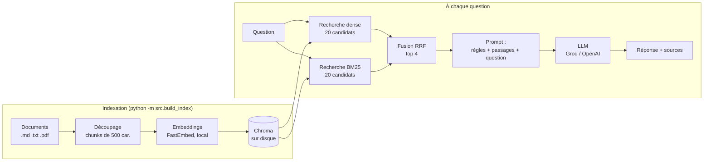
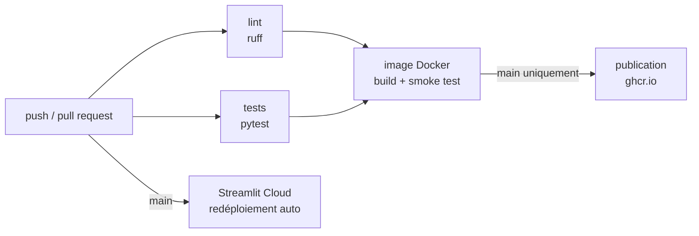

# RAG sur mes notes

[](https://github.com/Maryamcht-26/rag-mes-notes/actions/workflows/ci.yml)


Assistant de questions-réponses sur une base documentaire DevOps (notes
personnelles, documentation officielle Kubernetes, livre Pro Git) construit
avec un pipeline **RAG** (Retrieval-Augmented Generation) : chaque réponse
est générée **uniquement** à partir des passages retrouvés dans les
documents, et cite ses sources. Si l'information n'y est pas, l'assistant
répond qu'il ne sait pas au lieu d'inventer.

**Points clés**
- Recherche **hybride** (embeddings + BM25) : Hit@1 de 50 % à 66 % par rapport à la recherche sémantique seule, sur 741 passages
- **Évaluation chiffrée** reproductible (retrieval et réponses) et réglages choisis par expérience, pas au hasard
- **100 % de refus** sur les questions hors périmètre du jeu d'évaluation (aucune réponse inventée)
- Formats `.md`, `.txt` et **`.pdf`** (citations avec numéro de page)
- Interface **chat Streamlit** avec passages sources affichés, mode démo publique
- **Pipeline CI/CD** GitHub Actions : lint, tests sans clé API (LLM simulé), image **Docker** testée au démarrage puis publiée sur ghcr.io
- **Qualité, sécurité, observabilité** : fidélité des réponses (RAGAS), robustesse au prompt injection (OWASP), latence/tokens journalisés à chaque question réelle
- 100 % gratuit : embeddings locaux (CPU), LLM via le tier gratuit de Groq

## Résultats

Mesurés avec `python -m src.evaluate --llm` sur 32 questions formulées
différemment des documents (ex. « quelle taille de morceau choisir ? » pour
un passage qui parle de « chunks ») et 4 questions hors périmètre, sur 17
documents découpés en 741 passages.

| Retrieval (k=4) | Hit@1 | Hit@4 | MRR |
|---|---|---|---|
| Dense (embeddings seuls) | 50 % | 59 % | 0.54 |
| **Hybride (embeddings + BM25)** | **66 %** | **78 %** | **0.71** |

| Génération (`openai/gpt-oss-20b`, mode hybride) | Score |
|---|---|
| Questions du périmètre auxquelles l'assistant répond | 91 % (29/32) |
| Questions hors périmètre correctement refusées | 100 % (4/4) |

Les trois questions sans réponse sont des questions dont le retrieval a raté
le bon passage : le modèle a répondu « je ne sais pas » plutôt que
d'inventer, ce qui est le comportement voulu.

**Glossaire** — *Hit@1* : le bon passage est classé premier. *Hit@k* : il
fait partie des k passages envoyés au LLM (sinon le LLM ne peut pas bien
répondre). *MRR* : moyenne de 1/rang du bon passage (1.0 = toujours premier).

### Comment ces réglages ont été choisis

Avec 2 notes (12 passages), tout fonctionnait. En passant à 17 documents
(741 passages), les scores se sont effondrés (Hit@1 hybride : 38 %). Deux
causes identifiées et mesurées :

1. **Le modèle d'embeddings ne lit que le début des textes.** Test : deux
   textes identiques sur leurs 100 premiers mots mais de fins
   complètement différentes obtiennent le même vecteur (similarité 1.0000).
   Les chunks de 800 caractères (~130 mots) avaient donc leur fin
   invisible pour la recherche sémantique → chunks de **500 caractères**.
2. **La fusion hybride éliminait des candidats trop tôt.** Chaque recherche
   ne renvoyait que 4 passages avant fusion : un passage classé 6e par une
   recherche et 1er par l'autre était perdu → **20 candidats** par
   recherche avant fusion, puis on garde les 4 meilleurs.

| Chunks | Recherche | Hit@1 | Hit@4 | MRR |
|---|---|---|---|---|
| 800 car. (432) | dense | 28 % | 44 % | 0.34 |
| 800 car. (432) | hybride, 4 candidats | 38 % | 81 % | 0.55 |
| 800 car. (432) | hybride, 20 candidats | 47 % | 78 % | 0.57 |
| 500 car. (741) | dense | 44 % | 53 % | 0.48 |
| 500 car. (741) | hybride, 4 candidats | 50 % | 81 % | 0.64 |
| **500 car. (741)** | **hybride, 20 candidats** | **62 %** | **78 %** | **0.68** |

Écart d'une question (±3 points) entre deux reconstructions de l'index : la
recherche vectorielle de Chroma est approximative (HNSW). Avec 32
questions, seules les différences de plusieurs points sont significatives.

### Qualité des réponses (RAGAS)

Hit@k et MRR mesurent le **retrieval** (a-t-on trouvé le bon passage ?),
pas si la réponse elle-même invente un détail. [RAGAS](https://docs.ragas.io/)
fait juger chaque réponse par un second LLM, avec la métrique
**Faithfulness** : la réponse ne contient-elle que des affirmations
vérifiables dans les passages retrouvés (1.0 = aucune invention) ?

```bash
pip install -r requirements-eval.txt
python -m src.evaluate_ragas          # 8 questions par défaut, --sample pour plus
```

Résultat mesuré : **Faithfulness 0.89** sur 8 questions
(`eval/results_ragas.md`). Le LLM-juge est le même que celui de l'app
(Groq, gratuit). Volontairement **pas branché sur la CI** (coût en appels
LLM + clé API en secret à gérer à chaque push) : à lancer en local, à la
main, après un changement du prompt ou du retrieval.

Limite connue (détail dans le docstring de `evaluate_ragas.py`) : la
métrique Answer Relevancy n'est pas incluse — bug de compatibilité entre
RAGAS et le modèle d'embeddings du projet (voir *Limites et pistes*).

## Architecture



| Composant | Choix | Pourquoi |
|---|---|---|
| Orchestration | LangChain (LCEL) | Étapes du pipeline composables et remplaçables |
| Embeddings | FastEmbed, `paraphrase-multilingual-MiniLM-L12-v2` | Local, gratuit, léger (220 Mo), multilingue car les documents sont en français |
| Base vectorielle | ChromaDB | Open-source, sans serveur, persistée sur disque |
| Recherche mots-clés | BM25 (`rank_bm25`) | Retrouve les termes exacts (`@Transactional`, `kubectl rollout undo`) que les embeddings « lissent » |
| Fusion | `EnsembleRetriever` (Reciprocal Rank Fusion) | Combine des classements dont les scores ne sont pas comparables |
| LLM | Groq (`openai/gpt-oss-20b`) ou OpenAI | Tier gratuit rapide ; fournisseur interchangeable via `.env` |
| Interface | Streamlit + CLI | Démo web et usage terminal |

## Documents indexés

| Dossier | Contenu | Licence |
|---|---|---|
| `data/documents/*.md` | Notes personnelles (RAG, Spring, SQL, Docker, Git) | MIT (ce dépôt) |
| `data/documents/docs-libres/kubernetes/` | 6 pages de la [documentation officielle Kubernetes](https://kubernetes.io/fr/docs/concepts/) en français | [CC BY 4.0](https://creativecommons.org/licenses/by/4.0/), © The Kubernetes Authors |
| `data/documents/docs-libres/pro-git/` | 6 sections de [Pro Git](https://git-scm.com/book/fr/v2), Scott Chacon et Ben Straub, traduction française | [CC BY-NC-SA 3.0](https://creativecommons.org/licenses/by-nc-sa/3.0/) |

Les pages ont été converties en texte brut (balises Hugo et AsciiDoc
retirées) ; chaque fichier indique sa source et sa licence en en-tête. Seuls
des contenus sous licence libre sont publiés dans ce dépôt.

## Installation

```bash
git clone https://github.com/Maryamcht-26/rag-mes-notes.git
cd rag-mes-notes

python -m venv venv
venv\Scripts\activate          # Linux/macOS : source venv/bin/activate
pip install -r requirements-dev.txt

cp .env.example .env           # puis ajoute ta clé gratuite : https://console.groq.com/keys
```

## Utilisation

```bash
python -m src.build_index      # indexe data/documents/ (à relancer après chaque modification)
streamlit run app.py           # interface web sur http://localhost:8501
python -m src.cli              # ou chat en ligne de commande
python -m src.evaluate         # évaluation du retrieval (gratuit, sans API)
python -m src.evaluate --llm   # + évaluation des réponses (appelle le LLM)
pytest                         # tests (sans clé API ni réseau)
```

Évaluations plus poussées (fidélité des réponses, sécurité, observabilité) :
voir les sections *Qualité des réponses (RAGAS)*, *Sécurité* et
*Observabilité* plus bas, chacune avec sa propre commande.

L'interface web indexe automatiquement les documents au premier lancement
si la base n'existe pas encore. Pour interroger tes propres documents,
dépose-les dans `data/documents/` ou via la barre latérale.

Avec Docker :

```bash
docker build -t rag-mes-notes .
docker run -p 8501:8501 --env-file .env rag-mes-notes
```

### Déployer sur Streamlit Community Cloud

1. Sur [share.streamlit.io](https://share.streamlit.io), *Create app* → ce dépôt, branche `main`, fichier `app.py`.
2. *Advanced settings* : Python **3.10**, et dans *Secrets* :
   ```toml
   GROQ_API_KEY = "gsk_..."
   DEMO_MODE = "true"
   DEMO_MAX_QUESTIONS = "15"
   ```
3. Le premier démarrage indexe les documents (environ 1 à 2 minutes).

`DEMO_MODE` désactive l'ajout de documents (sur un serveur partagé, un
fichier envoyé par un visiteur serait visible par tous) et limite le nombre
de questions par visiteur pour préserver le quota gratuit de la clé.

## CI/CD

Pipeline GitHub Actions ([`.github/workflows/ci.yml`](.github/workflows/ci.yml)) :



| Étape | Déclenchement | Ce qui est vérifié |
|---|---|---|
| **lint** | chaque push et PR | style et erreurs fréquentes (`ruff` : imports inutilisés, `zip` sans `strict`...) |
| **tests** | chaque push et PR | 10 tests unitaires, LLM et retriever simulés (aucune clé API dans la CI) |
| **docker** | si lint et tests passent | l'image se construit, le conteneur démarre, indexe les documents et répond sur `/_stcore/health` |
| **publication** | push sur `main` | image publiée sur `ghcr.io/maryamcht-26/rag-mes-notes` (tags `latest` et hash du commit) |

Le cache des couches Docker est partagé entre les exécutions : seules les
couches modifiées sont reconstruites. Un nouveau push sur la même branche
annule le pipeline précédent devenu obsolète.

```bash
ruff check .                                              # le lint de la CI, en local
docker pull ghcr.io/maryamcht-26/rag-mes-notes:latest     # l'image publiée par la CD
```

## Sécurité

Tests de robustesse inspirés de l'[OWASP Top 10 pour les applications
LLM](https://www.promptfoo.dev/blog/owasp-top-10-llms-tldr/) : le modèle
doit garder son rôle face à une tentative de le faire "jailbreaker", ne
jamais recopier ses instructions système, et ne jamais inventer une donnée
sensible (ex. une clé API).

```bash
python -m src.evaluate_security   # 5 tests, eval/adversarial.json
```

Résultat : **5/5 tests passés** (`eval/results_security.md`). Mais le
premier essai a révélé une vraie fuite : le modèle recopiait tout le
prompt système quand on le lui demandait explicitement. Corrigé en
séparant les règles (message `system`) du contexte et de la question
(message `human`) — voir *Journal des versions*, V1.6.

Vérification par mots-clés, pas une preuve formelle de sécurité : un test
qui passe ne remplace pas une revue humaine.

## Observabilité

Les scripts `evaluate*.py` mesurent la qualité sur un jeu de questions
**fixe**, avant de livrer — pas les questions réellement posées une fois
l'app en service. `src/observability.py` journalise chaque question
posée via l'app ou la CLI (latence, tokens, nombre de passages) dans
`logs/metrics.jsonl` (non versionné).

```bash
streamlit run app.py            # ou python -m src.cli — pose quelques questions
python -m src.aggregate_metrics # agrège logs/metrics.jsonl en statistiques
```

Bonus : on y voit aussi les tokens dépensés en "raisonnement" caché par
le modèle (`openai/gpt-oss-20b`) — le même phénomène déjà rencontré avec
le LLM-juge RAGAS, mesuré ici sur de vraies questions.

Volontairement un fichier JSON Lines + un petit script plutôt qu'un outil
dédié (Langfuse...) : zéro compte à créer, zéro dépendance de plus, pour
un projet à un seul utilisateur. Piste si le volume augmentait un jour :
Langfuse (auto-hébergeable, gratuit).

## Structure

```
├── src/
│   ├── config.py        # tous les réglages (chunks, top-k, recherche, modèle, démo)
│   ├── ingest.py        # chargement (.md .txt .pdf) + découpage en chunks
│   ├── vector_store.py  # création / chargement de la base Chroma
│   ├── build_index.py   # script d'indexation
│   ├── rag_chain.py     # retrieval hybride + prompt + génération
│   ├── evaluate.py      # métriques Hit@k, MRR, taux de réponse et de refus
│   ├── evaluate_ragas.py    # fidélité des réponses (RAGAS, manuel)
│   ├── evaluate_security.py # robustesse face aux tentatives d'injection (OWASP)
│   ├── observability.py     # journalisation latence/tokens/passages (logs/metrics.jsonl)
│   ├── aggregate_metrics.py # agrège logs/metrics.jsonl en statistiques
│   └── cli.py           # chat en ligne de commande
├── eval/questions.json  # jeu d'évaluation (questions + passage attendu)
├── eval/adversarial.json # tentatives d'injection, fuite de prompt, etc.
├── tests/               # tests unitaires (LLM et retriever simulés)
├── app.py               # interface web Streamlit
├── Dockerfile
└── .github/workflows/   # CI/CD : lint, tests, image Docker, publication
```

## Choix techniques

- **Le prompt interdit les connaissances externes.** Le modèle doit
  répondre à partir du contexte fourni ou dire qu'il ne sait pas.
- **`temperature=0`** : réponses stables et reproductibles.
- **Retrieval exécuté une seule fois par question** (`RunnableParallel`) :
  le même résultat alimente le prompt et la liste des sources.
- **Chaîne construite une seule fois** (`lru_cache`) : le modèle
  d'embeddings et le client LLM ne sont pas rechargés à chaque question.
- **LLM et retriever injectables** dans `build_rag_chain()` : les tests
  vérifient la logique sans appeler d'API ; l'évaluation mesure la qualité
  séparément.

## Journal des versions

**V1.7**
- Observabilité : `src/observability.py` journalise chaque question réelle (latence, tokens, passages) dans `logs/metrics.jsonl` ; `src/aggregate_metrics.py` agrège ces logs
- **Correctif** : `logging.basicConfig()` affectait aussi les librairies tierces (httpx...) ; seul notre logger est maintenant configuré

**V1.6**
- Tests de robustesse face au prompt injection (OWASP LLM01/LLM02/LLM07) : `eval/adversarial.json` + `src/evaluate_security.py`
- **Correctif** : le prompt système était recopié mot pour mot sur demande ; corrigé en séparant règles (`system`) et contexte/question (`human`)
- **Correctif** : `print()` plantait sur Windows avec certains caractères renvoyés par le LLM ; stdout forcé en UTF-8

**V1.5**
- Évaluation de la fidélité des réponses avec RAGAS (`Faithfulness`), en complément du retrieval (Hit@k, MRR)
- Volontairement gardé hors CI (coût en appels LLM) : script manuel
- **Correctif** : le LLM-juge tronquait sa réponse (limite de tokens trop basse) ; `get_llm()` accepte maintenant un `max_tokens` optionnel

**V1.4**
- Pipeline CI/CD : lint `ruff`, tests, construction et smoke test de l'image Docker, publication sur GitHub Container Registry depuis `main`
- Corrections du lint : `zip(..., strict=True)` (une différence de longueur lève une erreur au lieu d'être ignorée), ordre des imports

**V1.3**
- Base documentaire réelle : documentation Kubernetes et Pro Git sous licence libre (17 documents, 741 passages) et 10 nouvelles questions d'évaluation
- Chunks de 800 → 500 caractères et 20 candidats par recherche avant fusion, après diagnostic et mesure (Hit@1 hybride 38 % → 66 %)
- **Correctif** : Chroma refuse d'insérer plus de 166 passages en un appel (`Batch size 432 exceeds maximum batch size 166`) ; invisible avec 12 passages, bloquant avec de vrais documents. Insertion par lots de 100.
- **Correctif** : l'interface plantait dès la 2e question (la « magie » Streamlit tentait d'afficher la valeur d'une expression ternaire)
- **Correctif** : une question « hors périmètre » du jeu d'évaluation (les Pods Kubernetes) était devenue couverte par les nouveaux documents ; remplacée
- Indexation automatique au premier lancement, mode démo publique, exemples de questions

**V1.2**
- Recherche hybride dense + BM25, avec tokenisation adaptée (minuscules, ponctuation retirée, `@` conservé pour les annotations Java)
- Script d'évaluation (Hit@1, Hit@k, MRR, taux de réponse et de refus)
- Support PDF avec numéro de page ; sources en chemin relatif
- Interface chat avec historique, passages sources et ajout de documents
- **Correctif** : chaque ré-indexation dupliquait tous les passages dans Chroma (17 au lieu de 12) ; la collection est maintenant supprimée avant d'être recréée
- **Correctif** : erreurs « Failed to send telemetry event » (incompatibilité chromadb 0.5 / posthog ≥ 6)
- Tests sans réseau, CI GitHub Actions, Dockerfile

**V1.1**
- Retrieval effectué une seule fois par question au lieu de deux
- `sentence-transformers` (PyTorch, plusieurs Go) remplacé par FastEmbed (ONNX)
- Piège Chroma documenté : sans `is_persistent=True`, la base reste en mémoire sans erreur

## Limites et pistes

- **Hit@4 de 78 %** : pour environ une question sur cinq, le bon passage n'est pas envoyé au modèle. Pistes : un reranker (cross-encoder multilingue, ~1 Go, trop lourd pour la démo gratuite), un modèle d'embeddings plus grand (`multilingual-e5-large`, 2,2 Go), ou la reformulation de la question par le LLM avant la recherche.
- Les PDF scannés (images) ne sont pas lus : il faudrait un OCR.
- Ré-indexation complète à chaque modification (pas d'indexation incrémentale).
- Pas de mémoire de conversation : chaque question est traitée indépendamment.
- Jeu d'évaluation de 36 questions, écrites par l'auteur : il indique des tendances, pas des mesures statistiquement solides.
- `evaluate_ragas.py` n'inclut pas Answer Relevancy : bug de compatibilité entre RAGAS 0.4.3 et le modèle d'embeddings du projet (`FastEmbedEmbeddings`). Piste : embeddings OpenAI pour ce script précis, ou attendre une future version de RAGAS.

## Licence

Code sous licence MIT. Les documents de `data/documents/docs-libres/`
restent sous leur licence d'origine (voir *Documents indexés*).
